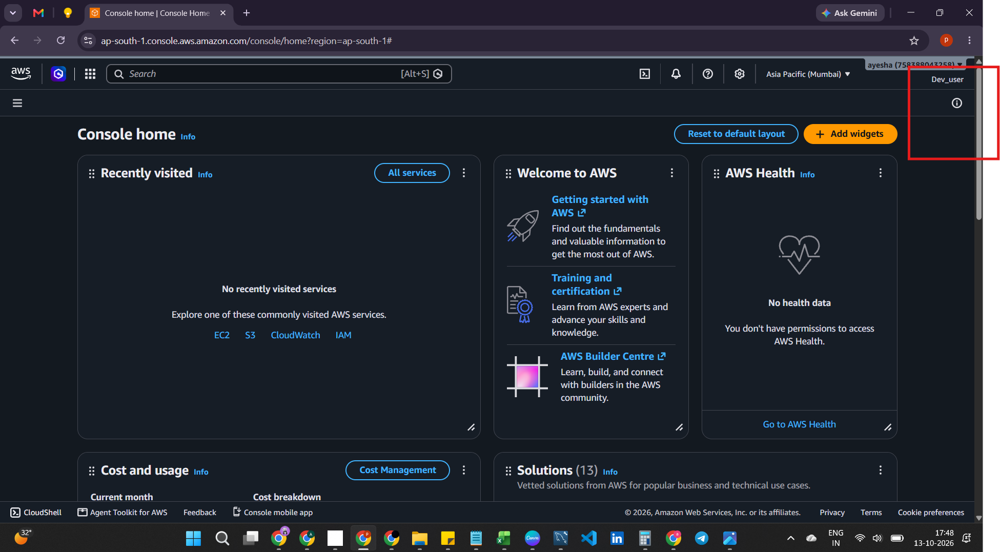
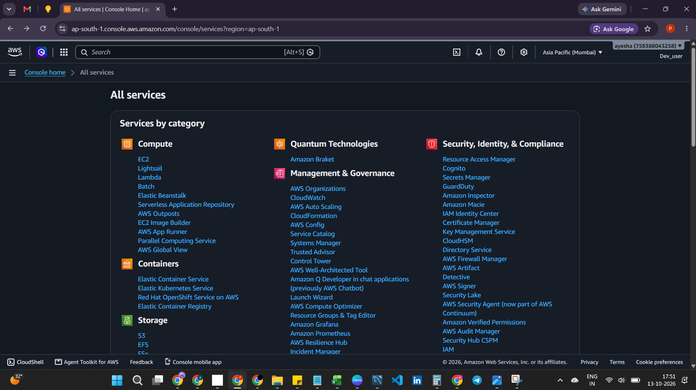
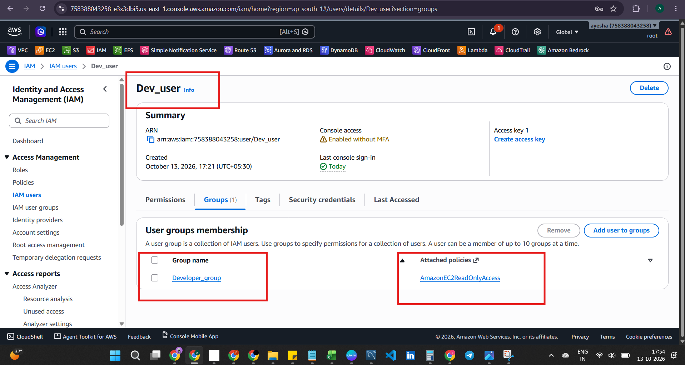
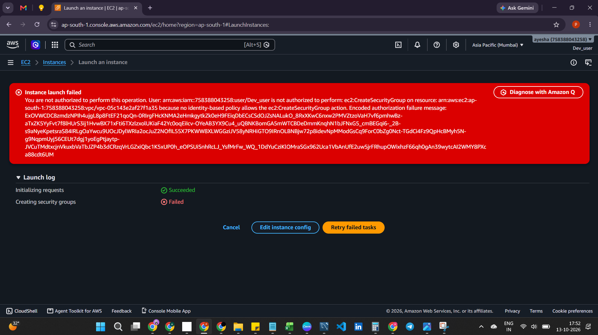
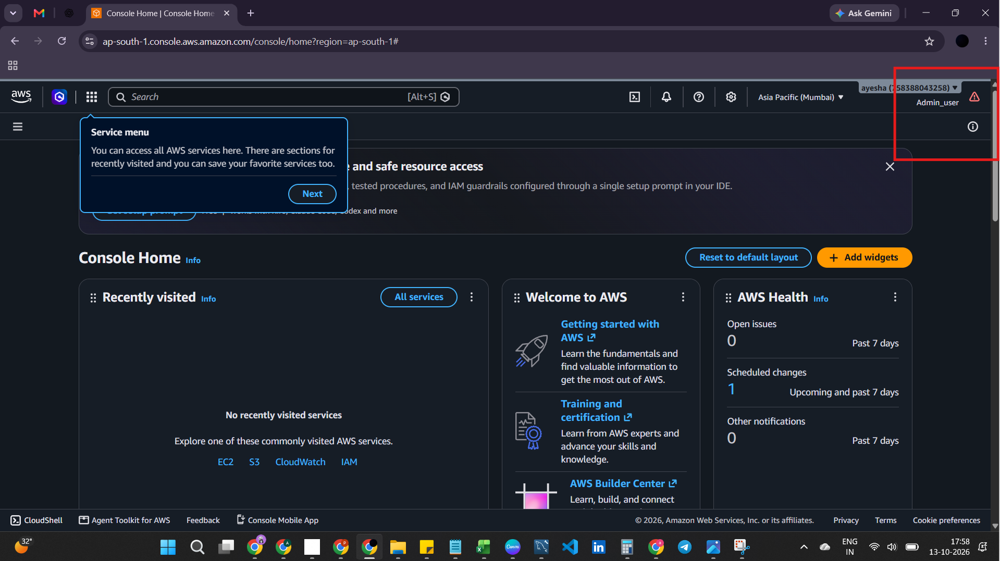
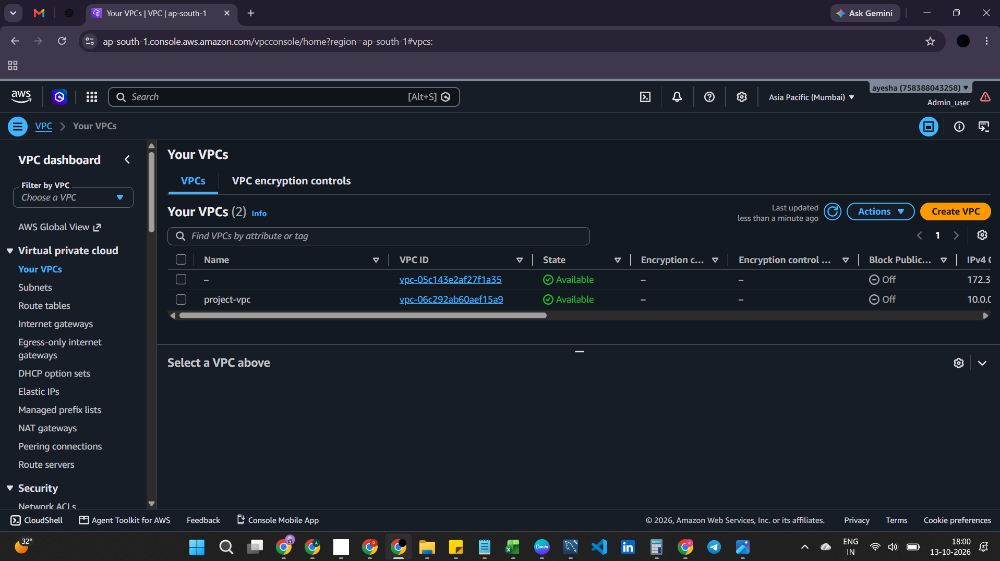
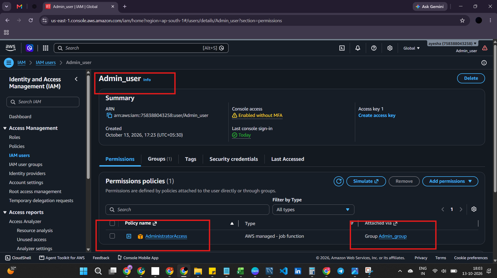

Architecture Design

The project uses the following structure:

```
AWS Account
|
|-- IAM Group: Developers
|   |
|   |-- IAM User: dev-user
|   |
|   |-- Policy: ReadOnlyAccess
|
|-- IAM Group: Admins
    |
    |-- IAM User: admin-user
    |
    |-- Administrative permissions
```


# AWS IAM Project Implementation Steps


## 1. Objective

The objective of this implementation is to configure AWS IAM users and groups, assign permissions, and test access controls.
The results help explain how AWS IAM supports access control and why permissions should follow the principle of least privilege.


## 2. Step 1: Access the AWS IAM Console

1. Sign in to the AWS Management Console.
2. Search for IAM in the AWS service search bar.
3. Open the IAM dashboard.
4. Verify that you are working in the correct AWS account.


## 3. Step 2: Create the 'Developers' & 'admin' Group

1. Open User groups in IAM.
2. Select Create group.
3. Enter `Developers` as the group name.
4. Select the AWS managed policy `EC2ReadOnlyAccess`.
5. Create the group.
6. Verify that the policy is attached.
7. Repeat the same for admin group with policy "administratoraccess"


## 4. Step 3: Create the Developer & admin User

1. Open Users in IAM.
2. Select Create user.
3. Enter `dev-user` as the username.
4. Add the user to the `Developers` group.
5. Complete user creation.
6. Verify the user's group membership.
7. Repeat the same for admin user and add under "admin" group


## 6. Step 5: Test Permissions

Performed the following tests and recorded the actual results.

### Developer (dev-user)

| Test | Expected Result | Actual Result |
|------|-----------------|---------------|
| Developer sign-in | Successful | Successful |
| View permitted AWS resources | Allowed where authorized | Successfully viewed resources |
| Attempt a resource-creation action | Denied where no permission allows it | Access denied |
| Verify group membership | Correct membership | dev-user belongs to Developers group |
| Verify attached policy | Is attached successfully | Is attached successfully |

### Admin (admin-user)

| Test | Expected Result | Actual Result |
|------|-----------------|---------------|
| Admin sign-in | Successful | Successful |
| View permitted AWS resources | Allowed where authorized | Successfully viewed resources |
| Attempt a resource-creation action | Creation successful due to full access | Successful |
| Verify group membership | Correct membership | admin-user belongs to Admins group |
| Verify attached policy | Is attached successfully | Is attached successfully |


## 7. Step 6: Capture Evidence

Captured screenshots of:

**Developer sign-in**



**Read-only access (Developers group policy)**



**Developer group membership and permissions**



**Access-denied test (resource creation blocked)**



**Admin sign-in**



**Admin resource creation (successful)**



**Admin group membership and permissions**




## 8. Step 7: Document the Project on GitHub

1. Create a GitHub repository named `aws-iam-access-management`.
2. Add a `README.md` file.
3. Upload this implementation guide and the Test results documentation.
4. Add sanitized screenshots to the `screenshots` folder.
5. Review the repository for credentials and sensitive information.
6. Commit the completed documentation.


## 9. References

- [AWS IAM User Guide](https://docs.aws.amazon.com/IAM/latest/UserGuide/)
- [AWS IAM Security Best Practices](https://docs.aws.amazon.com/IAM/latest/UserGuide/best-practices.html)
